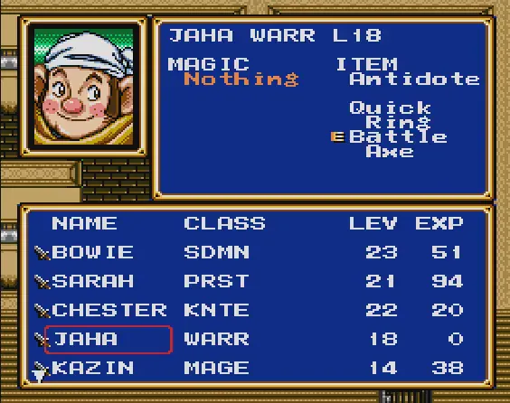
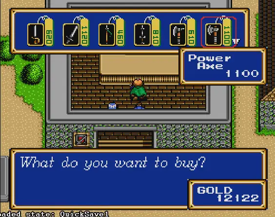

Get that party menu wrapping!

Trade in a party member’s equipped weapon when buying a new one!

Grab the patches under [Releases](https://github.com/motovilec/Shining-Force-2-QoL/releases) and apply them to the US version of Shining Force II (`22defc2e8e6c1dbb20421b906796538725b3d893`).

Thanks to the [SF2DISASM project](https://github.com/ShiningForceCentral/SF2DISASM) for making my first ROM hacking experience much smoother!